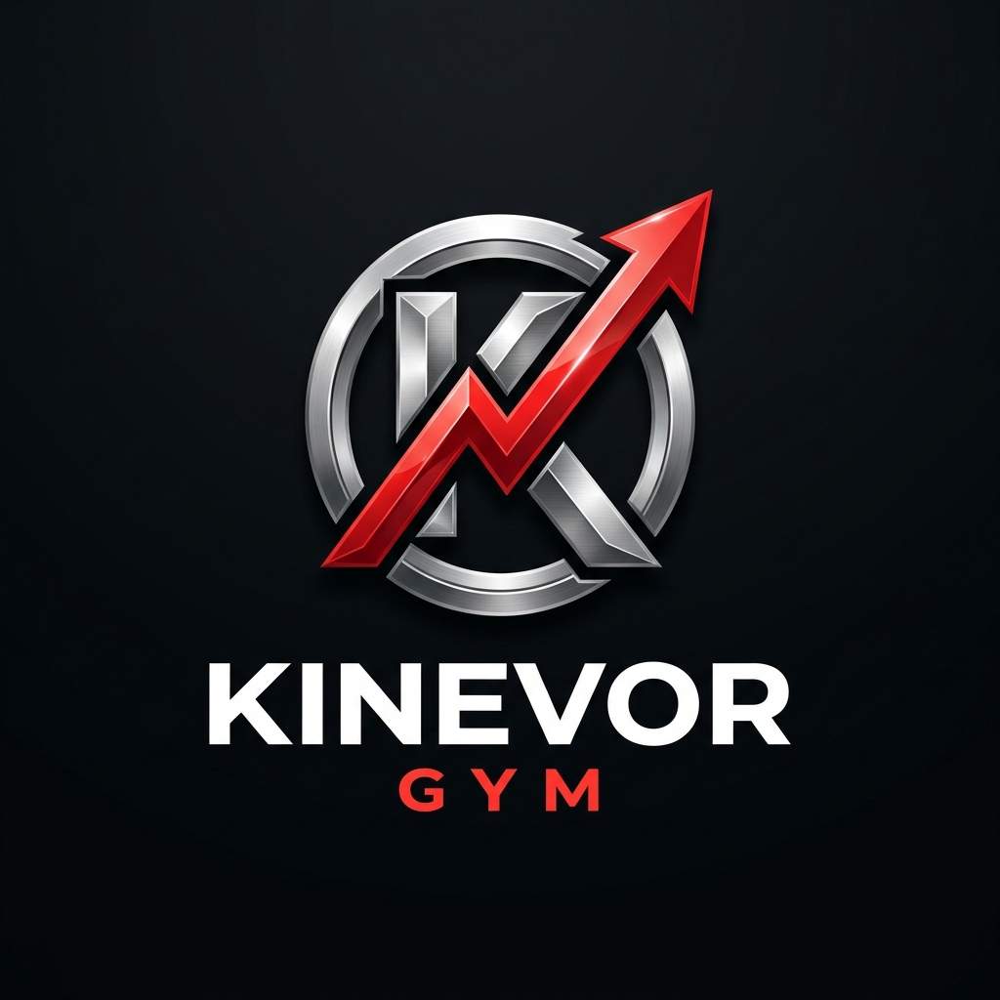
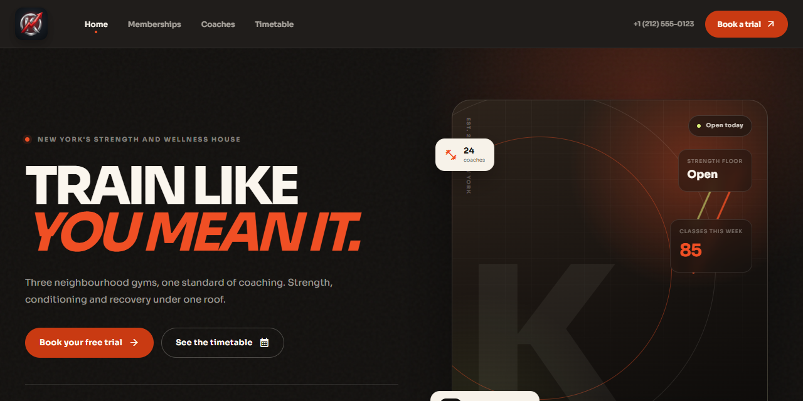
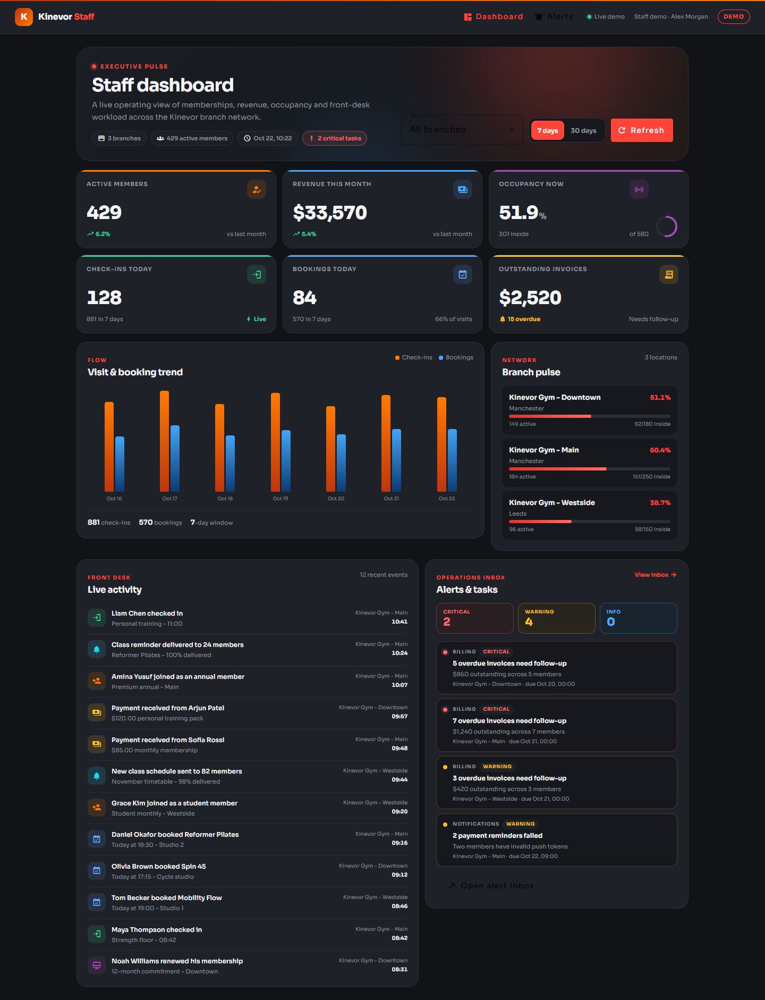
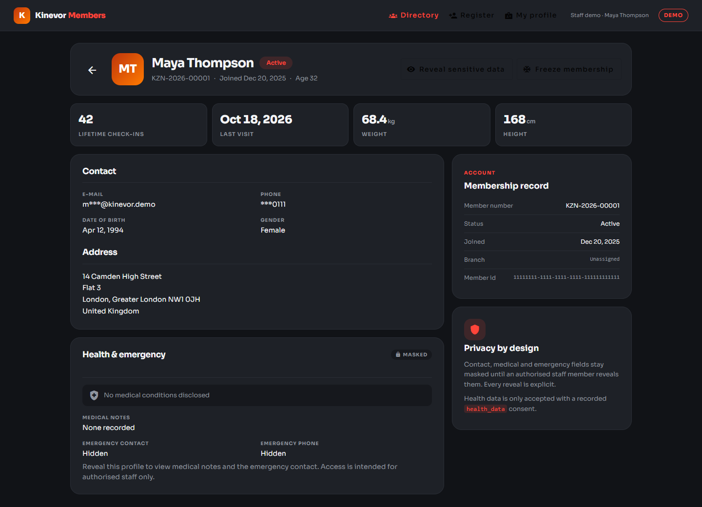
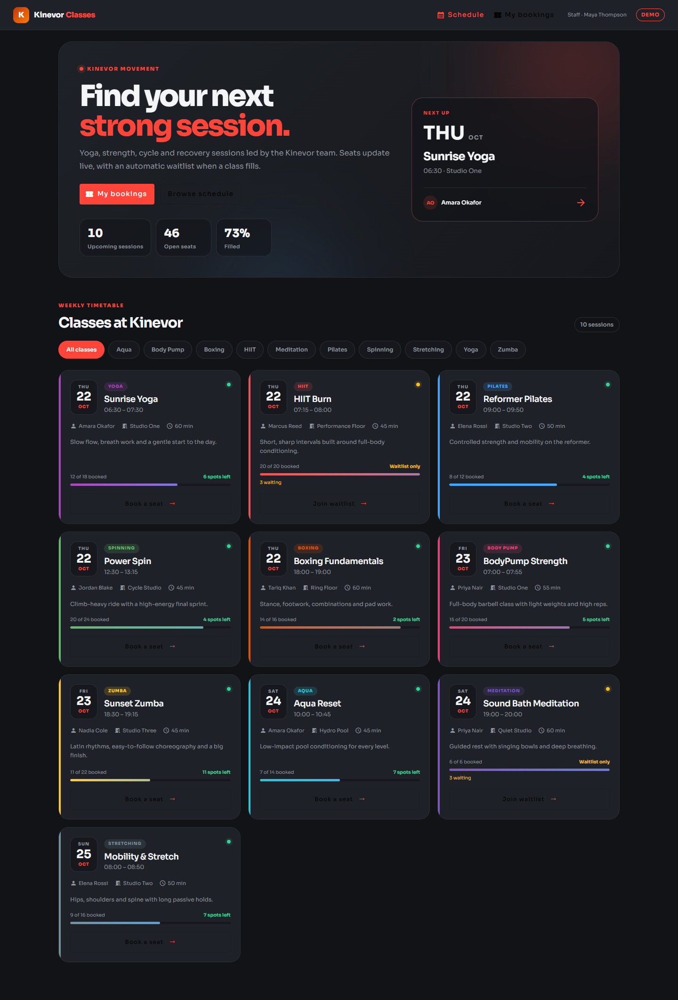
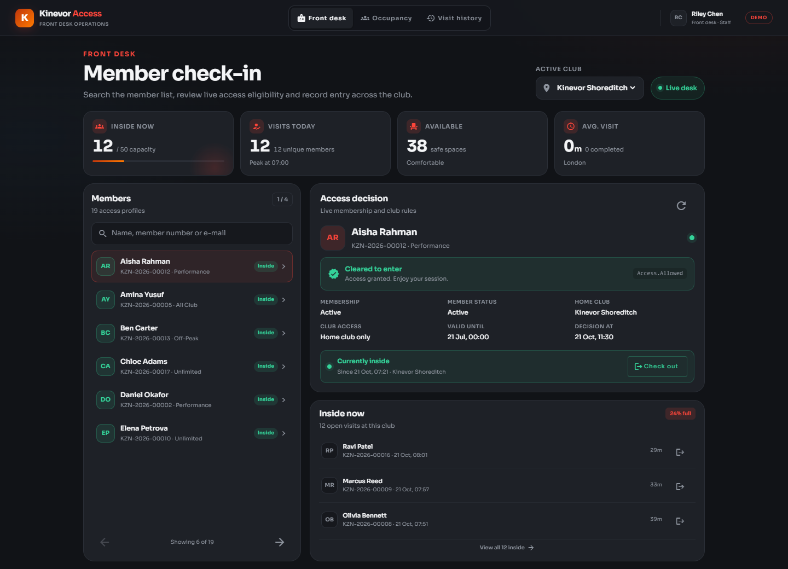
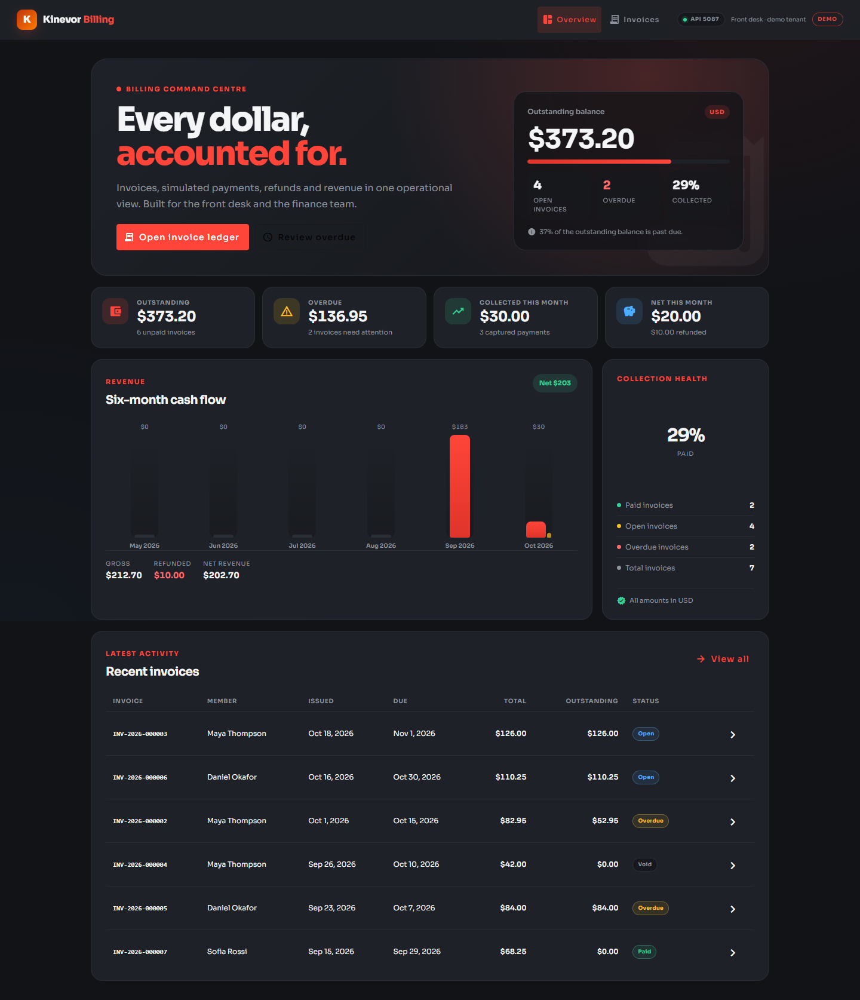
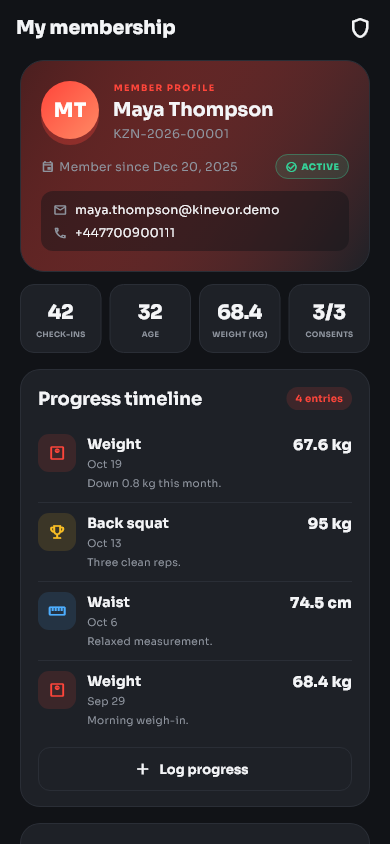
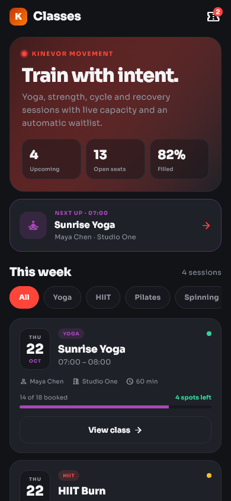
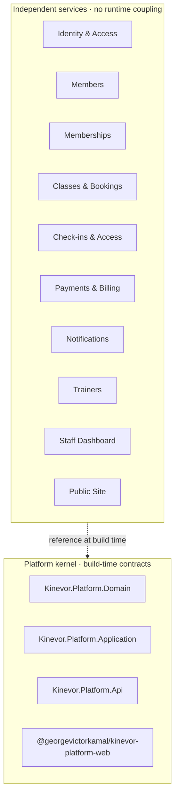

<p align="center">
  
</p>

<h1 align="center">Kinevor</h1>

<p align="center">
  <strong>A modular gym-management platform — ten independent services, one repository.</strong><br>
  Built with .NET 10, Angular 22, Flutter 3 and a shared platform kernel.
</p>

<p align="center">
  <a href="https://github.com/georgevictorkamal/Kinevor-Gym/actions/workflows/ci.yml"></a>
  <a href="https://github.com/georgevictorkamal/Kinevor-Gym/releases/latest"></a>
  <a href="https://dotnet.microsoft.com/"></a>
  <a href="https://angular.dev/"></a>
  <a href="https://flutter.dev/"></a>
  <a href="LICENSE"></a>
</p>

<p align="center">
  <a href="#-screenshots">Screenshots</a> •
  <a href="#-quick-start">Quick Start</a> •
  <a href="ARCHITECTURE.md">Architecture</a> •
  <a href="#-services">Services</a> •
  <a href="CONTRIBUTING.md">Contributing</a>
</p>

---



## 🎯 What is Kinevor?

Kinevor is a **reference implementation** of a gym-management product built around
**service boundaries, layered backend design, reusable frontend packages and
automated verification**.

Each of the ten business modules owns its domain rules, HTTP API, SQLite database
and test suite. Where the capability needs a UI, it also ships a standalone
Angular library and/or a Flutter package. The shared platform kernel provides
domain primitives, application contracts, the API response envelope and Angular
client services.

> **Not a distributed system.** Modules share versioned platform contracts at
> build time, but they do _not_ call each other, share databases or require each
> other at runtime. Every demo API starts on its own port with its own seeded
> SQLite file. See [ARCHITECTURE.md](ARCHITECTURE.md).

## ✨ Key Features

<table>
<tr>
<td width="50%">

### 🏗️ Modular Architecture
Ten independently buildable services with explicit boundaries — no cross-module
project references. Each can be split into its own repository without changing
application code.

</td>
<td width="50%">

### 🔁 Full-Stack Per Module
Every service ships its own .NET API, Angular library and/or Flutter package,
plus Swagger docs, demo data and screenshots. A complete vertical slice from
domain to UI.

</td>
</tr>
<tr>
<td>

### ✅ 435 Automated Tests
208 .NET + 99 Angular + 128 Flutter tests covering domain rules, HTTP endpoints,
gateways, components, screen states and golden layouts — all passing in CI.

</td>
<td>

### ⚙️ CI with Matrix Builds
GitHub Actions matrices prove every module builds and tests independently.
CodeQL scans C# and TypeScript. Dependabot watches NuGet, npm, pub and Actions.

</td>
</tr>
<tr>
<td>

### 🌍 i18n & RTL Ready
The Angular platform package includes English/Arabic localization with RTL
layout, locale-aware dates, numbers and currency formatting.

</td>
<td>

### 📱 Cross-Platform
Web (Angular 22 with signals and standalone components), mobile (Flutter with
Material 3 and golden tests) and API (ASP.NET Core 10 with MediatR CQRS).

</td>
</tr>
</table>

## 📊 At a Glance

| | |
| --- | --- |
| **Business modules** | 10, plus a shared platform kernel |
| **Backend** | 10 ASP.NET Core 10 APIs, EF Core 10, SQLite, MediatR |
| **Web** | 9 Angular 22 libraries with runnable demos |
| **Mobile** | 9 Flutter packages with runnable examples |
| **Automated tests** | **435** — 208 .NET · 99 Angular · 128 Flutter |
| **Screenshots** | 57 captured from the running applications |
| **CI** | Platform build, backend/web/mobile matrices, CodeQL, Dependabot |

## 🖼️ Screenshots

| Public site | Staff dashboard |
| --- | --- |
|  |  |

| Members | Classes & bookings |
| --- | --- |
|  |  |

| Check-ins & access | Payments & billing |
| --- | --- |
|  |  |

| Members on mobile | Classes on mobile |
| --- | --- |
|  |  |

<details>
<summary><strong>📸 57 more screenshots</strong> across Swagger explorers, staff workflows, member screens and mobile states</summary>
<br>

Each module's `docs/screenshots/` folder contains its full set — API explorer,
web views and mobile screens. Browse:
[identity](kinevor-identity-access/docs/screenshots/) ·
[members](kinevor-members/docs/screenshots/) ·
[memberships](kinevor-memberships/docs/screenshots/) ·
[classes](kinevor-classes-bookings/docs/screenshots/) ·
[check-ins](kinevor-checkins-access/docs/screenshots/) ·
[payments](kinevor-payments-billing/docs/screenshots/) ·
[notifications](kinevor-notifications/docs/screenshots/) ·
[trainers](kinevor-trainers/docs/screenshots/) ·
[dashboard](kinevor-staff-dashboard/docs/screenshots/) ·
[public site](kinevor-public-site/docs/screenshots/)

</details>

## 🧩 Services

| Service | Responsibility | API | Web | Flutter | Port |
| --- | --- | :---: | :---: | :---: | ---: |
| [`kinevor-platform`](kinevor-platform/README.md) | Shared kernel: domain primitives, application contracts, API envelope, Angular services | — | ✔ | — | — |
| [`kinevor-identity-access`](kinevor-identity-access/README.md) | JWT authentication, refresh tokens and role-aware sessions | ✔ | ✔ | ✔ | 5082 |
| [`kinevor-members`](kinevor-members/README.md) | Member records, health context, progress, consents and privacy | ✔ | ✔ | ✔ | 5083 |
| [`kinevor-memberships`](kinevor-memberships/README.md) | Plans, subscriptions, renewal and benefit snapshots | ✔ | ✔ | ✔ | 5084 |
| [`kinevor-classes-bookings`](kinevor-classes-bookings/README.md) | Timetable, capacity, bookings and waitlists | ✔ | ✔ | ✔ | 5085 |
| [`kinevor-checkins-access`](kinevor-checkins-access/README.md) | Eligibility rules, check-in/out, occupancy and visit history | ✔ | ✔ | ✔ | 5086 |
| [`kinevor-payments-billing`](kinevor-payments-billing/README.md) | Invoices, simulated payments, refunds and revenue reporting | ✔ | ✔ | ✔ | 5087 |
| [`kinevor-notifications`](kinevor-notifications/README.md) | Inbox, delivery records, preferences, templates and suppressions | ✔ | — | ✔ | 5088 |
| [`kinevor-staff-dashboard`](kinevor-staff-dashboard/README.md) | Branch-scoped KPIs, trends, occupancy and operational alerts | ✔ | ✔ | ✔ | 5089 |
| [`kinevor-trainers`](kinevor-trainers/README.md) | Trainer directory, profiles and public-facing roster | ✔ | ✔ | ✔ | 5081 |
| [`kinevor-public-site`](kinevor-public-site/README.md) | Marketing site, plans, timetable and trial capture | ✔ | ✔ | — | 5090 |

## 🏛️ Architecture



Each module follows layered conventions — **Domain → Application → API → EF Core → DemoApi** — with tests beside the code they verify. The platform supplies `ApiResponse<T>`, authorization policies and Angular auth/i18n/theme services.

[📖 Full architecture guide →](ARCHITECTURE.md)

## 🛠️ Technology

| Layer | Stack |
| --- | --- |
| **Backend** | ASP.NET Core 10 (`net10.0`), EF Core 10, SQLite, MediatR 12, JWT bearer, PBKDF2, Swashbuckle, xUnit + `WebApplicationFactory` |
| **Web** | Angular 22 — standalone components, signals, typed gateways/facades, Angular Material, Vitest |
| **Mobile** | Flutter 3.35+ (verified 3.47.8), Material 3, typed HTTP client + repository, widget + golden tests |
| **Tooling** | GitHub Actions matrices, NuGet, npm, Dart/Flutter, Mermaid, CodeQL, Dependabot |

## 🚀 Quick Start

### Prerequisites

| Tool | Version |
| --- | --- |
| .NET SDK | **10** |
| Node.js | **22.22.3+** (Node 24 LTS recommended) with **npm 11+** |
| Flutter | **3.35+** |

### 1. Build the platform (once)

```bash
# Pack the shared .NET packages
dotnet pack kinevor-platform/backend/Kinevor.Platform.slnx -c Release \
  -o kinevor-platform/backend/artifacts/packages

# Build the shared Angular package
cd kinevor-platform/web
npm ci
npm run build
cd ../..
```

### 2. Run any service

Pick a module — **members** is a good starting point:

```bash
# API + Swagger → http://localhost:5083
dotnet run --project kinevor-members/backend/samples/Kinevor.Modules.Members.DemoApi
```

```bash
# Angular demo → http://localhost:4202
cd kinevor-members/web
npm run install:local
npm start
```

```bash
# Flutter example (Chrome)
cd kinevor-members/mobile/packages/kinevor_members/example
flutter pub get
flutter run -d chrome
```

> **Tip:** `npm run install:local` binds the module workspace to the sibling
> platform build, installs dependencies and restores `package.json`. Use the same
> pattern for any module — see its README for the exact port and routes.

The demo APIs use development-only role headers for screenshots and tests.
See [SECURITY.md](SECURITY.md) for details.

## 🧪 Testing

| Suite | Tests | Result |
| --- | ---: | --- |
| .NET — platform + 10 module APIs | 208 | ✅ passed |
| Angular — 9 module libraries | 99 | ✅ passed |
| Flutter — 9 packages | 128 | ✅ passed |
| **Total** | **435** | **✅ all passed** |

```bash
# Backend
dotnet test kinevor-members/backend/Kinevor.Modules.Members.slnx -c Release

# Web
cd kinevor-members/web && npm run install:local && npm test

# Mobile
cd kinevor-members/mobile/packages/kinevor_members && flutter test
```

## 🔄 Continuous Integration

The [CI workflow](.github/workflows/ci.yml) runs on every push and pull request:

1. **Platform backend** — restore, build, test and pack the .NET kernel
2. **Platform web** — install and build the Angular package
3. **Module backend matrix** — each API builds and tests independently
4. **Module web matrix** — each Angular workspace tests and builds independently
5. **Module mobile matrix** — each Flutter package analyzes, formats and tests

A separate [CodeQL workflow](.github/workflows/codeql.yml) scans C# and
TypeScript weekly, and [Dependabot](.github/dependabot.yml) checks NuGet, npm,
pub and Actions dependencies. A tag-driven [Release workflow](.github/workflows/release.yml)
packages the tracked source tree as one zip and publishes it with a GitHub
release.

## 📁 Repository Layout

```text
kinevor/
├── kinevor-platform/           shared kernel: .NET packages + Angular library
├── kinevor-identity-access/    backend/ · web/ · mobile/ · docs/
├── kinevor-members/            backend/ · web/ · mobile/ · docs/
├── kinevor-memberships/        backend/ · web/ · mobile/ · docs/
├── kinevor-classes-bookings/   backend/ · web/ · mobile/ · docs/
├── kinevor-checkins-access/    backend/ · web/ · mobile/ · docs/
├── kinevor-payments-billing/   backend/ · web/ · mobile/ · docs/
├── kinevor-notifications/      backend/ · mobile/ · docs/
├── kinevor-trainers/           backend/ · web/ · mobile/ · docs/
├── kinevor-staff-dashboard/    backend/ · web/ · mobile/ · docs/
├── kinevor-public-site/        backend/ · web/ · docs/
├── docs/branding/              logo and brand assets
├── docs/screenshots/           portfolio showcase images
├── .github/workflows/          CI and CodeQL pipelines
├── ARCHITECTURE.md             design and conventions
├── SECURITY.md                 security policy and demo caveats
├── CONTRIBUTING.md             how to build, test and contribute
├── CODE_OF_CONDUCT.md          community standards
└── CHANGELOG.md                release history
```

## 💡 Design Highlights

- **Explicit service boundaries** — one business capability per module, no
  cross-module references
- **Reusable contracts** — platform packages keep the response envelope,
  policies and client services consistent
- **Tests next to the code** — domain, handler, endpoint, component and golden
  tests live beside what they verify
- **Working demos** — every module ships a seeded API, a web demo and/or a mobile
  example, plus Swagger and screenshots
- **Realistic workflows** — masked member data, consent history, waitlists,
  access rules, refunds, occupancy and billing KPIs

## ⚠️ Scope & Limitations

This is a portfolio reference implementation, deliberately scoped:

- Services are independent and **not orchestrated** — no API gateway, message bus
  or cross-service transaction
- Payments are simulated; notifications do not call an external provider
- SQLite is used for zero-setup demos, not for production scale
- Demo auth headers are development-only; hosts refuse to start outside
  Development
- Package publishing to registries is optional and documented per module

## 📚 Documentation

| Document | Description |
| --- | --- |
| [Architecture](ARCHITECTURE.md) | Design, conventions and module anatomy |
| [Security](SECURITY.md) | Security policy, demo caveats and deployment checklist |
| [Contributing](CONTRIBUTING.md) | How to build, test and open a change |
| [Code of Conduct](CODE_OF_CONDUCT.md) | Community standards |
| [Changelog](CHANGELOG.md) | Release history |

**Module READMEs:**
[platform](kinevor-platform/README.md) ·
[identity](kinevor-identity-access/README.md) ·
[members](kinevor-members/README.md) ·
[memberships](kinevor-memberships/README.md) ·
[classes](kinevor-classes-bookings/README.md) ·
[check-ins](kinevor-checkins-access/README.md) ·
[payments](kinevor-payments-billing/README.md) ·
[notifications](kinevor-notifications/README.md) ·
[trainers](kinevor-trainers/README.md) ·
[dashboard](kinevor-staff-dashboard/README.md) ·
[public site](kinevor-public-site/README.md)

## 👤 Author

**George Victor Kamal** — [@georgevictorkamal](https://github.com/georgevictorkamal)

The public repository is
[`georgevictorkamal/Kinevor-Gym`](https://github.com/georgevictorkamal/Kinevor-Gym).
The Angular packages use the `@georgevictorkamal/*` scope and are built from this
monorepo; they are not yet published to a public npm registry. See each module's
`PUBLISHING.md` for the optional GitHub Packages flow.

## 📄 License

[MIT](LICENSE) — free to use, modify and distribute.

---

<p align="center">
  If you found this helpful, consider giving it a ⭐
</p>
